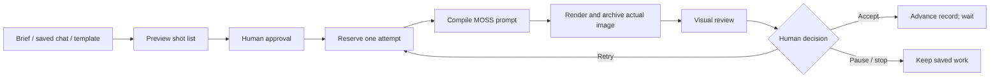

# Foundry · experimental production bench

Foundry turns a brief or a saved Grimoire script into an approved shot list, then lets you generate and review **one actual image at a time**. It is a separate experiment. Your Grimoire chats, applied Spell Scroll prompts and existing workflows stay independent.

**[Download the testing workflow](../workflows/experimental/01-foundry-single-frame-moss.json)** · [Model downloads](MODEL_DOWNLOADS.md)

## First test

1. Update Prompt Mage, restart ComfyUI when convenient, refresh the browser and open the testing workflow. Select your installed MOSS model filenames. The accelerator LoRA and sampling settings come from the main workflow; no character LoRA is included.
2. Leave the assistant source empty for **Local Qwen** using the shared encoder. Or select a saved Grimoire chat: Foundry copies that chat’s saved provider, model, thinking, visual style and recent context. OpenAI/DeepSeek use their existing server-saved keys. The selected model must support image input and native text generation. Unsupported models fail visibly; Foundry never silently switches paid providers.
3. Leave **Frames = 1**. The default caps are three tries per frame, three total render attempts and eight assistant calls. These count attempts, not a price guarantee. Increase them deliberately for a longer script.
4. Choose a template and write the brief. **Keep consistent** describes continuity. **Reviewer checks** describes what success should look like. Appearance Overrides is optional and disabled in the sample; enable selected replacements before planning.
5. Click **Preview plan**. Inspect and edit every frame’s brief and observable checks, then **Approve plan**. Approval makes no model call. It freezes the assistant settings, appearance recipe, canvas, plan and budgets for this run.
6. Click **Render & review one frame**. Foundry writes a native MOSS JSON prompt, runs the connected image pipeline, archives the decoded image and sends those actual pixels to the same selected assistant for review.
7. Inspect the image and evidence. **Accept frame** records your choice and advances the frame counter; it does **not** render the next frame. Press Render again when ready. **Retry · fresh seed** keeps the same compiled prompt and changes the seed. Reviewer suggestions are displayed, never automatically applied.

**Recommended DeepSeek model:** choose **DeepSeek V4.1 Flash · Recommended · Text + images** in Foundry’s **Assistant model** dropdown. The key panel appears below it; add a key once or reuse the server-saved DeepSeek key. This explicit preset overrides the selected chat’s provider/model, keeping its script context and visual style. All three stages use `deepseek-flash`. Local Qwen remains the default; selection alone sends no AI request.

The official [model table](https://api-docs.deepseek.com/quick_start/pricing/) and [vision guide](https://api-docs.deepseek.com/guides/vision/) checked November 10, 2026 identify `deepseek-flash` as V4.1 Flash with image input. V4 Pro does not support vision, so Foundry rejects it before planning spends calls. Legacy V4 Flash/Vision-Exp names route to the current Flash model; the preset uses the current API ID. Provider aliases, rates and policies may change.

Use Foundry’s panel buttons rather than global Run. The sample wires Foundry’s prompt, seed, dimensions and run IDs into the pipeline. A normal global Run cannot reserve a fresh attempt. Exactly one **Foundry · Review Output** must receive the final decoded image and the matching run/attempt IDs. Latent batch size must be one.

## Templates and saved work

Built-in starting points: single scene, holiday carousel, character lookbook, storyboard and product campaign. They describe a structure, not a fixed character or story. A selected Grimoire conversation supplies creative context; the new brief and approved shot list take priority over older summaries.

After approval, expand **Save this approved plan as a template**. Reusing its unchanged brief and frame count copies the saved plan without calling the planner. Change the brief to request a new plan. A template does not save API keys, conversation history or the appearance recipe; select those for the new run.

Saved runs reopen from the picker. Refreshing, opening a run, editing the plan, approving, accepting and saving templates make no AI requests. The panel size is saved with the workflow.

## Review and recovery

The reviewer must assess each approved check as **pass**, **fail** or **uncertain**, with visible evidence. Foundry derives the overall verdict from those checks. Cropped or obscured details should be uncertain. Reviews can still be wrong: use your eyes, and accept a non-passing image explicitly if it is right for the project.

If visual review fails after generation, the captured PNG remains saved. **Review saved image** spends another assistant call but does not run diffusion again. Invalid JSON and provider failures stop visibly without automatic retries. Failed API requests can still be billable.

**Pause/Stop** stops further work on this run. It does not interrupt unrelated ComfyUI jobs. An image or API request already in progress may finish; a completed image is retained. Cancel an active job in ComfyUI’s queue if needed. Once it has left the queue, **Recover interrupted job** moves the record to a state where you can review its saved image or reserve another attempt. A failed planning job needs a new plan. Stop is final for that run.

## How it works

- **Durable controller:** JSON run records under `ComfyUI user/prompt_mage/foundry/runs`. Approved plans and per-frame compiled prompts are frozen separately from Grimoire. Attempt IDs distinguish duplicate/cached graph executions. A server lock makes reservation and budget checks atomic.
- **Bounded workers:** one planning call; one composition call per new frame; one visual review per attempt. Retries reuse the frame prompt. Calls are charged to the run before provider execution. No hidden repair calls, self-rewriting prompts or automatic acceptance.
- **Queue boundary:** native ComfyUI partial execution retains the full graph for cache stability but targets only the requested worker or explicitly paired review/image-save outputs. It never queues a nested graph while waiting inside an executing node. Opening the UI does not start jobs.
- **Actual-image capture:** Review Output archives one PNG under `foundry/images/<run>/<attempt>.png` before review, then downsizes only the review copy to a one-megapixel budget. Saved image dimensions are not changed. Keep RunPod’s ComfyUI user directory on persistent storage.
- **Separation:** source settings and recent context are copied once. Grimoire messages, compacted memory and Spell Scroll approval are not modified. Run records contain prompts, context and reviews in plaintext; use a trusted private server. API keys remain in the existing credential store and never enter the workflow or template.

## Current limits

This is a **manual production bench**, not an unattended agent. There is no automatic next-frame loop, semantic prompt rewriting, cross-frame image comparison or resumable diffusion checkpoint. Closing the browser does not cancel a job already queued. After completion, reopening the panel reads the saved result; it does not launch the next frame. One server’s stored run IDs are not portable to a fresh pod without its persistent user directory.

Local Qwen generation and MOSS diffusion may compete for VRAM. Foundry adds no forced model-unload step; ComfyUI still manages memory. Performance depends on the shared encoder, installed model and hardware. The sample keeps the main workflow’s MOSS base/accelerator settings; file installation requirements still apply.

Validation covers state transitions, budgets, saved-image recovery, JSON contracts, queue targets and workflow wiring with mocked AI providers. The component preview uses fixture data. This release has **not** been validated by a paid API production run, a full GPU image run or deployment on RunPod.
