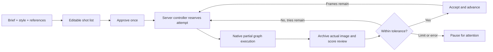

# Foundry · automated production bench

**Preview a script, approve it once, then Foundry renders → reviews → retries or accepts → moves to the next frame.** The controller runs on the ComfyUI server, independently of the browser. Your existing Grimoire chats and applied Spell Scroll prompts are separate.

**[Testing workflow](../workflows/experimental/01-foundry-single-frame-moss.json)** · [Model downloads](MODEL_DOWNLOADS.md)

## Start a sequence

1. Open the separate testing workflow. Select your installed MOSS filenames. The supplied accelerator LoRA and sampling settings come from the main workflow; there is no character LoRA. Leave latent batch size at one.
2. Choose **Style / theme** and **Assistant model** explicitly. The full Archmage photo/anime/illustration presets and custom notes are available. Local Qwen uses the connected native encoder. DeepSeek V4.1 Flash is the recommended API option; selecting it opens the existing persistent-key panel. Selecting options makes no AI request.
3. Choose a script template and write the brief. Set **Frames** and **Tries per frame**. Foundry suggests total render/call limits for that count; inspect or change them under **Advanced · spending limits**. Seven frames no longer inherit a three-render cap. A new plan must allow at least one render and two assistant calls per frame, plus planning.
4. Add optional **Planning images**. Drop images into the gallery, upload files, or choose a local folder—even on RunPod. Numbered thumbnails preserve your order; use the arrows to reorder, × to remove, and Clear to empty the gallery. Select a role under each image: outfit, pose, props, setting, visual style or character. **What should we borrow?** gives additional instructions, such as “Image 1: use only the outfit; keep my character.” Up to twelve images are supported across the gallery and optional single image socket. There are no growing rows of image sockets.
5. **Optional · borrow context from a Grimoire chat** supplies recent script ideas. This is not the assistant/model selector and does not replace your selected style. Leave it empty if unnecessary. Appearance Overrides controls your selected character traits and takes priority over borrowed identity details.
6. Click **Preview plan**. Edit the briefs and observable checks. Prefix a check with **!** only when it is genuinely non-negotiable, such as “! The red cloak is visible.” Ordinary details can vary within your tolerance.
7. Click **Approve & start sequence**. Foundry freezes the plan, style, assistant settings, appearance recipe, resolution, tolerance, limits and connected generation graph. It automatically processes one image at a time and saves every attempt. Closing the browser does not stop it while the ComfyUI server remains running.

**Automatic** is the default. **Manual** remains available under After plan approval; it stops after each review. Manual acceptance has no confirmation dialog, and the next button reads **Render & review next frame**. Normal global Run does not reserve a new attempt; use Foundry’s panel.

## Review tolerance

The reviewer inspects the actual decoded image. It scores each approved check and the image’s visible usability, with evidence. Foundry computes prompt match from those checks and applies the selected policy on the server.

| Tolerance | Average prompt match | Minimum individual check | Image usability |
| --- | --- | --- | --- |
| Relaxed | 65/100 | 35/100 | 55/100 |
| Balanced (default) | 75/100 | 50/100 | 65/100 |
| Strict | 90/100 | 75/100 | 80/100 |

These are **AI judgments, not measured similarity or confidence probabilities**. Balanced accepts useful differences in pose angles, folds, small props and background placement. A clearly major visible defect blocks automatic acceptance. A **! must-have** must be visibly present and pass with at least 70/100. Uncertain or failed checks cannot be inflated by a contradictory high numerical score.

If an image meets tolerance, it is accepted and the next frame is queued. Otherwise Foundry retries the same prompt with a fresh seed, within the frame and global limits. It does not silently rewrite your approved scene. After exhausted retries, it pauses for attention; it does not automatically accept a bad frame or extend its budget.

Inspect any attempt using the attempt picker. **Accept & continue** accepts the selected reviewed attempt immediately and continues the sequence—no “are you sure?” question. This is also how you override an overly strict reviewer. In Manual mode, Accept only advances the record; Render & review next frame starts the next image.

## Physical inspection and collection folders

New reviews separately inspect **anatomy**, **scene geometry**, **garment/material continuity** and **lighting/perspective**. The inspector traces visible body connectivity, support, hand/object contact and occlusion; a pretty face or high prompt score cannot override a major visible defect. Intentional crops, body shapes and foreshortening are not defects by themselves. The panel shows evidence for each category separately from prompt-match details.

| Physical score floor | Anatomy / scene geometry | Clothing / light |
| --- | --- | --- |
| Relaxed | 70 | 60 |
| Balanced | 85 | 80 |
| Strict | 90 | 85 |

**Physical inspection** has its own Relaxed/Balanced/Strict selector, independent of prompt-match tolerance. A major defect always blocks automatic acceptance. Uncertain categories cannot pass through an inflated score. Object-only scenes may mark anatomy not applicable. These are still fallible vision judgments; inspect the accepted collection before publishing. Old completed reviews are retained and labelled as legacy rather than silently re-scored. Explicit saved-image recovery refreshes an old reply if it lacks the new inspection fields. Detail crops increase API image-token usage but do not add a separate review request.

Choose **IG carousel**, then write what kind of carousel you want; the template does not assume a holiday. Switching templates preserves your custom brief.

The planner proposes a **Project name**, editable before approval. New collections use that readable name under **ComfyUI output/PromptMage-Foundry**, or the optional **Custom folder name**. Duplicate names receive a numeric suffix. All native render tries stay in **attempts**; accepted frames are copied into **accepted**, preferring native PNGs to retain their workflow metadata. **collection.json** lists the accepted frame files. Existing UUID-based folders are kept unchanged. Internal run IDs remain stable.

## References, templates and persistence

Image roles and the borrowing instructions accompany the planner’s request. Vision APIs receive the planning images directly. Local Qwen describes each image first, which adds one assistant call per reference; the descriptions and planned outfit details persist for later prompt compilation. The planner must turn borrowed details into concrete shot briefs rather than writing only “same as reference.” References do not get re-analysed on every retry.

Gallery uploads use the same server-owned attachment store as Grimoire. Files go to the ComfyUI server; images are subsequently sent to the selected API provider only when you request planning. Key values never enter the workflow. Gallery file IDs and roles are saved with it; they require the same persistent server data to reopen.

Built-in templates include a single scene, IG carousel, character lookbook, storyboard and product campaign. Save an approved plan as a reusable template from its expandable section. Reusing an unchanged saved plan without new references skips the planning call. Templates do not embed API keys or chat history.

Runs, reviews and frozen prompts live under **ComfyUI user/prompt_mage/foundry/runs**. Actual PNG attempts live under **foundry/images**; the full reviewed image is retained while the vision API receives a full view (up to 1.5 MP) plus two detail crops (up to 0.9 MP each) in one request; Local Qwen receives only the full view. Frozen workflow snapshots live under **foundry/jobs**. Keep this directory and Grimoire’s attachment/credential storage on persistent RunPod storage. These are private plaintext server records; protect server access.

## Pause, errors and recovery

**Pause** prevents the next submission; a current render/API call may finish. **Resume sequence** continues from saved progress and can review an already captured image without running diffusion again. **Stop** ends the run. These controls never globally interrupt someone else’s ComfyUI job. Cancel a current image through ComfyUI’s queue if needed.

Provider errors, malformed replies, cancellation, exhausted retries and spending limits stop with a visible explanation. There are no automatic retries of failed API requests. **Review saved image** recovers an unfinished review without another render, then resumes an automatic sequence. Reviewer replies are saved privately under `foundry/reviews`, bound to the exact PNG hash. Recovery first tries reparsing that reply for free; if it is unusable, the explicit recovery action can make one fresh review request. Already submitted requests may still be billable. A server restart is different from closing the browser: reopen the saved run and resume/recover it explicitly; jobs lost from ComfyUI’s queue are not silently replayed.

Common status variants (such as Passed or Partially met) and numeric strings are normalized. Partial matches can meet Relaxed/Balanced tolerance but cannot satisfy **! must-have** checks; Strict still rejects them. An unfamiliar status never turns into a pass and does not trigger an image rerender merely because the review format was unreadable.

## Architecture and validation

The server controller uses ComfyUI’s native prompt validation and queue/history primitives, submitting a new job only after the prior job has finished. It keeps the complete graph for cache stability but targets only the explicitly paired review/image saver. No execution node waits on a nested queued graph. Reservations and budget updates are atomic; duplicate starts share one controller task per run. The browser displays server events and never drives the automatic loop.

Tests cover automatic multi-frame completion without browser callbacks, fresh-seed retries, tolerance policies, must-haves, limits, cancellation, pause/stop, duplicate starts, saved-image review, reference roles, image forwarding and gallery persistence. Automated tests mock AI/diffusion; the component preview uses fixture data.

A live two-frame smoke test also completed on an RTX 3090 using ComfyUI 0.42.0, MOSS base, custom LoRAs and `res_2s` at 1728 × 2144. DeepSeek Flash borrowed a teal shirt from a supplied image, composed both prompts, reviewed the actual outputs and automatically accepted/advanced through both frames: two renders, five assistant calls. The reviewer's match scores were 92 and 90, with usability 88 for each. These scores are subjective, and one successful sequence is not a quality benchmark. Live rejected-frame retries and RunPod deployment remain unverified; those control paths have automated test coverage. Inspect early results before committing a long sequence.

DeepSeek’s [official model table](https://api-docs.deepseek.com/quick_start/pricing/) and [vision guide](https://api-docs.deepseek.com/guides/vision/) identify `deepseek-flash` as the V4.1 Flash image-capable API option. V4 Pro is text-only; Foundry rejects it for automatic image review. Provider aliases and pricing may change.

A bounded physical-inspection audit used two existing outputs without running diffusion again. The first rubric still accepted ambiguous clothing geometry and over-flagged the control. After calibration, the revised reviewer rejected the ambiguous garment construction and accepted the control. This is a small development check, not a reliability benchmark; model judgments vary and can still miss defects.
