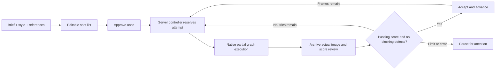

# Foundry · automated production bench

**Preview a script, approve it once, then Foundry renders → reviews → retries or accepts → moves to the next frame.** The controller runs on the ComfyUI server, independently of the browser. Your existing Grimoire chats and applied Spell Scroll prompts are separate.

**[Testing workflow](../workflows/experimental/01-foundry-single-frame-moss.json)** · [Model downloads](MODEL_DOWNLOADS.md)

## Start a sequence

1. Open the separate testing workflow. Select your installed MOSS filenames. The supplied accelerator LoRA and sampling settings come from the main workflow; there is no character LoRA. Leave latent batch size at one.
2. Choose **Style / theme** and **Assistant model** explicitly. The full Archmage photo/anime/illustration presets and custom notes are available. Local Qwen uses the connected native encoder. Select Local Qwen, DeepSeek Flash, OpenAI Terra/Sol or Gemini. Selecting an API model opens its own persistent-key panel. Selecting options makes no AI request.
3. Choose a script template and write the brief. Set **Frames** and **Tries per frame**. Foundry suggests total render/call limits for that count; inspect or change them under **Advanced · spending limits**. Seven frames no longer inherit a three-render cap. A new plan must allow at least one render and two assistant calls per frame, plus planning.
4. Add optional **Planning images**. Drop images into the gallery, upload files, or choose a local folder—even on RunPod. Numbered thumbnails preserve your order; use the arrows to reorder, × to remove, and Clear to empty the gallery. Select a role under each image: outfit, pose, props, setting, visual style or character. **What should we borrow?** gives additional instructions, such as “Image 1: use only the outfit; keep my character.” Up to twelve images are supported across the gallery and optional single image socket. There are no growing rows of image sockets.
5. **Optional · borrow context from a Grimoire chat** supplies recent script ideas. This is not the assistant/model selector and does not replace your selected style. Leave it empty if unnecessary. Appearance Overrides controls your selected character traits and takes priority over borrowed identity details.
6. Click **Preview plan**. Edit the briefs and observable checks. Prefix a check with **!** only when it is genuinely non-negotiable, such as “! The red cloak is visible.” Ordinary details can vary within your tolerance.
7. Click **Approve & start sequence**. Foundry freezes the plan, style, assistant settings, appearance recipe, resolution, tolerance, limits and connected generation graph. It automatically processes one image at a time and saves every attempt. Closing the browser does not stop it while the ComfyUI server remains running.

**Automatic** is the default. **Manual** remains available under After plan approval; it stops after each review. Manual acceptance has no confirmation dialog, and the next button reads **Render & review next frame**. Normal global Run does not reserve a new attempt; use Foundry’s panel.

## Passing score and automatic progression

**Passing score** defaults to the recommended **80/100** and can be changed from 50 to 100. The displayed overall score combines **40% prompt match + 25% image usability + 35% average applicable physical inspection**. The first passing attempt is accepted immediately; unused tries are not rendered. This replaces multiple competing score thresholds for new runs. Existing saved runs keep their original policy until you open **Adjust passing score / retry policy** and choose **Apply & continue**. This reassesses a saved review without another AI request, then continues Automatic mode. It does not re-plan the script.

A major visible defect, a failed physical category or missing **! must-have** blocks that image regardless of the overall score. Physical inspection has separate strictness: Balanced allows small imperfections but requires at least 60 in every applicable physical category; Relaxed requires 50; Strict requires 85 in anatomy/scene geometry and 80 in garments/lighting. Uncertain scores are capped below 60 and failed checks below 50. A must-have needs pass and at least 70. These are AI judgments, not measured accuracy. Inspect collections before posting.

**Automatic** approves the plan once, then renders, reviews, accepts/retries and advances on the server. **If all tries fail** defaults to **Continue automatically · flag the missing frame**. The run finishes its shot list, while clearly listing frames that need replacement. It never calls rejected images ready to post or copies them into `accepted`. Choose **Pause · let me review the attempts** to stop at that point instead. Provider errors, cancelled jobs and global spending caps still stop safely; automatic mode cannot guarantee every frame passes within finite limits.

**Manual** stops after each reviewed image. Inspect its breakdown and choose Accept frame or Retry this frame. After acceptance use Render & review next frame. Accept does not ask a second confirmation.

**Preview plan** only plans; it never renders an image. Preview plan and New plan are disabled during planning, rendering, reviewing or an active automatic sequence. This prevents a new preview from overlapping an earlier run. Opening a saved run and changing options do not make API calls.

## Anatomy, cohesion and collection folders

The inspector checks anatomy, support/contact/occlusion, garment continuity, and light/perspective/integration before assessing prompt match. API reviews receive the full view and two labelled crops of the same image in one request. Local Qwen receives the full view only. Crops increase image-token usage. Intentional crops, body shapes and foreshortening are not defects by themselves; reviews can still miss defects or over-flag details.

Choose **IG carousel**, then write its theme. Switching templates preserves your custom brief. Before approving, edit the AI **Project name**, or choose a custom collection folder. New outputs use `ComfyUI output/PromptMage-Foundry/<project>/attempts` and `accepted`. Duplicate folder names get a number; legacy folders stay unchanged. Native accepted PNGs preserve workflow metadata when available. `collection.json` lists accepted images, planned count and skipped frames; it does not publish anything to Instagram.

## API assistants

Foundry supports Local Qwen, DeepSeek Flash, OpenAI and Gemini. Each API provider has its own masked, persistent-key panel. Add, replace or remove affects only that provider. Keys stay in the ComfyUI user credential directory and are never serialized into workflows; persist that directory on RunPod.

- **OpenAI:** GPT-6.1 Terra is the recommended lower-cost Terra/Sol option; Sol, budget Luna and high-cost Astra are available. Text and image inputs use the [Responses API](https://developers.openai.com/api/docs/models/gpt-6.1-terra).
- **Gemini:** 3.8 Flash is recommended, with 3.5 Flash-Lite and 4 Argon alternatives from the [official model catalog](https://ai.google.dev/gemini-api/docs/models). The adapter uses [GenerateContent](https://ai.google.dev/api/generate-content), inline image data and an API-key header. Provider policies and model/project access apply.
- **DeepSeek:** Flash supports actual-image review. V4 Pro remains text-only and is not offered for this pipeline.

No paid request is retried automatically after a provider/connection error. API model availability and pricing may change. Gemini integration has mocked request/key/error coverage; a live Gemini test requires a Gemini key.

## References, templates and persistence

Image roles and the borrowing instructions accompany the planner’s request. Vision APIs receive the planning images directly. Local Qwen describes each image first, which adds one assistant call per reference; the descriptions and planned outfit details persist for later prompt compilation. The planner must turn borrowed details into concrete shot briefs rather than writing only “same as reference.” References do not get re-analysed on every retry.

Gallery uploads use the same server-owned attachment store as Grimoire. Files go to the ComfyUI server; images are subsequently sent to the selected API provider only when you request planning. Key values never enter the workflow. Gallery file IDs and roles are saved with it; they require the same persistent server data to reopen.

Built-in templates include a single scene, IG carousel, character lookbook, storyboard and product campaign. Save an approved plan as a reusable template from its expandable section. Reusing an unchanged saved plan without new references skips the planning call. Templates do not embed API keys or chat history.

Runs, reviews and frozen prompts live under **ComfyUI user/prompt_mage/foundry/runs**. Actual PNG attempts live under **foundry/images**; the full reviewed image is retained while the vision API receives a full view (up to 1.5 MP) plus two detail crops (up to 0.9 MP each) in one request; Local Qwen receives only the full view. Frozen workflow snapshots live under **foundry/jobs**. Keep this directory and Grimoire’s attachment/credential storage on persistent RunPod storage. These are private plaintext server records; protect server access.

## Pause, errors and recovery

**Pause** prevents the next submission; a current render/API call may finish. **Resume sequence** continues from saved progress and can review an already captured image without running diffusion again. **Stop** ends the run. These controls never globally interrupt someone else’s ComfyUI job. Cancel a current image through ComfyUI’s queue if needed.

Provider errors, malformed replies, cancellation, exhausted retries and spending limits stop with a visible explanation. There are no automatic retries of failed API requests. **Review saved image** recovers an unfinished review without another render, then resumes an automatic sequence. Reviewer replies are saved privately under `foundry/reviews`, bound to the exact PNG hash. Recovery first tries reparsing that reply for free; if it is unusable, the explicit recovery action can make one fresh review request. Already submitted requests may still be billable. A server restart is different from closing the browser: reopen the saved run and resume/recover it explicitly; jobs lost from ComfyUI’s queue are not silently replayed.

Common status variants (such as Passed or Partially met) and numeric strings are normalized. Partial matches can count toward the overall score but cannot satisfy **! must-have** checks. Strict physical inspection adds higher per-category minimums. An unfamiliar status never turns into a pass and does not trigger an image rerender merely because the review format was unreadable.

## Architecture and validation

The server controller uses ComfyUI’s native prompt validation and queue/history primitives, submitting a new job only after the prior job has finished. It keeps the complete graph for cache stability but targets only the explicitly paired review/image saver. No execution node waits on a nested queued graph. Reservations and budget updates are atomic; duplicate starts share one controller task per run. The browser displays server events and never drives the automatic loop.

Tests cover automatic multi-frame completion without browser callbacks, fresh-seed retries, tolerance policies, must-haves, limits, cancellation, pause/stop, duplicate starts, saved-image review, reference roles, image forwarding and gallery persistence. Automated tests mock AI/diffusion; the component preview uses fixture data.

A live two-frame smoke test also completed on an RTX 3090 using ComfyUI 0.42.0, MOSS base, custom LoRAs and `res_2s` at 1728 × 2144. DeepSeek Flash borrowed a teal shirt from a supplied image, composed both prompts, reviewed the actual outputs and automatically accepted/advanced through both frames: two renders, five assistant calls. The reviewer's match scores were 92 and 90, with usability 88 for each. These scores are subjective, and one successful sequence is not a quality benchmark. Live rejected-frame retries and RunPod deployment remain unverified; those control paths have automated test coverage. Inspect early results before committing a long sequence.

DeepSeek’s [official model table](https://api-docs.deepseek.com/quick_start/pricing/) and [vision guide](https://api-docs.deepseek.com/guides/vision/) identify `deepseek-flash` as the V4.1 Flash image-capable API option. V4 Pro is text-only; Foundry rejects it for automatic image review. Provider aliases and pricing may change.

A bounded physical-inspection audit used two existing outputs without running diffusion again. The first rubric still accepted ambiguous clothing geometry and over-flagged the control. After calibration, the revised reviewer rejected the ambiguous garment construction and accepted the control. This is a small development check, not a reliability benchmark; model judgments vary and can still miss defects.

The 1.26 OpenAI smoke test used GPT-6.1 Terra on a two-frame cafe carousel at 1728 × 2144. Preview plan produced zero image attempts. After one approval, the server rendered/reviewed/accepted both frames on their first tries, with overall scores 94 and 86: two renders, five assistant calls, no extra approvals. A separate short request also verified GPT-6.1 Sol connectivity. Gemini has request, image forwarding, key isolation and failure tests but was not live-tested without a configured Gemini key.

## Plan versions and visible progress

Preview plan appears in the header and persistent bottom action bar. Both are disabled once a preview is ready. Use **Regenerate plan** for another interpretation of the same planning inputs, or **Edit brief** to adjust inputs before explicitly previewing again. The previous run record stays saved; these actions do not approve or render images. **Cancel editing** returns to the existing preview. Approved plans stay frozen; use New plan after the sequence finishes or is stopped to begin another project.

The captured **Planning settings** overview shows model, style, canvas, run mode, score, physical policy, frame/try counts, spending caps, failure policy and reference count. Expand Brief and planning instructions to inspect the original direction. Header and footer previews remain disabled during processing.

When the decoded image is saved, the panel updates to **Reviewing saved image · waiting for [provider]** before the API call. It shows the actual image while review is pending, instead of continuing to show the reserved/rendering state. Active runs also refresh their status every five seconds, repainting only when the server record changes. API reviews may take longer than a render; provider timeouts still stop with a saved-image recovery path.

The 1.26.1 seven-frame test used the user's current OpenAI Terra configuration, two references, appearance, MOSS sampler and 1728 × 2144 canvas. These captured settings were compared before the run and matched. Preview generated zero images; one approval completed all seven frames with seven renders and fifteen assistant calls, no retries or skips. Overall reviewer scores were 94, 87, 97, 89, 94, 91 and 88. WebSocket monitoring confirmed seven saved-image review-stage events before provider completion. All accepted PNGs retained their native workflow metadata and the completed collection manifest listed seven files. This verifies the local pipeline, not a general image-quality benchmark or RunPod deployment.

## Conversational setup

Connect Grimoire’s production_brief output to Foundry and explicitly send an agreed brief. [Grimoire → Foundry guide](GRIMOIRE_FOUNDRY.md). Import fills a new draft while keeping Foundry’s model, keys and spending caps; later chat does not alter it.
